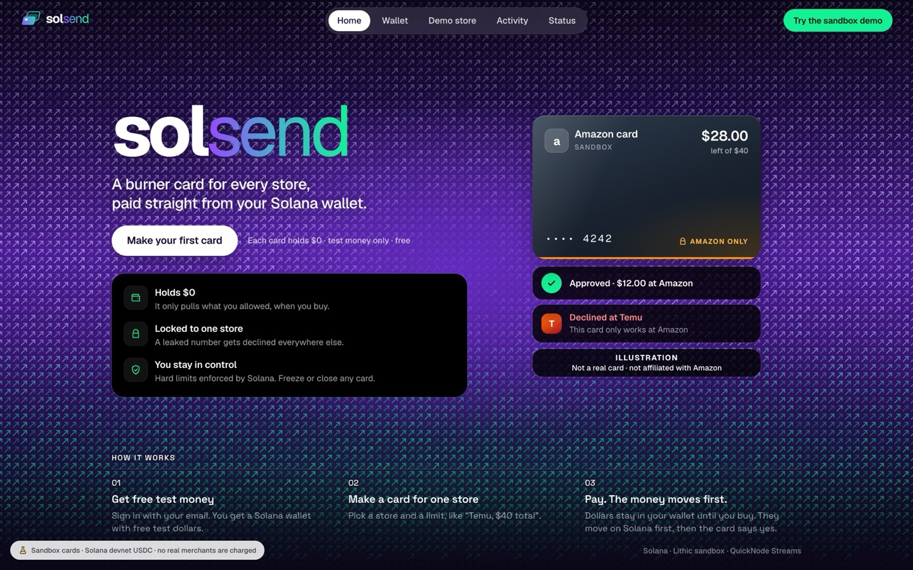
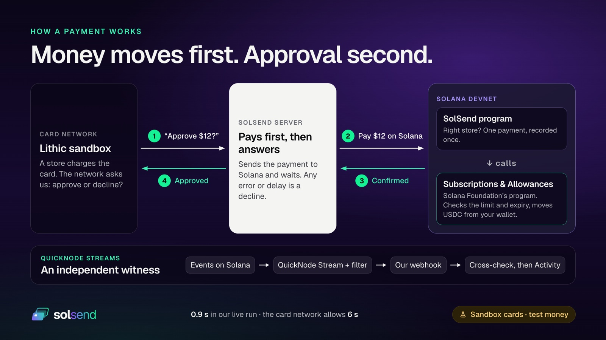

# SolSend

**A burner card for every store. Your money stays in your wallet until the moment you pay.**

[**Live app**](https://solsend-ashen.vercel.app) · [Try it](#try-it-30-seconds) · [How it uses Solana](#how-solsend-uses-solana) · [QuickNode Streams](#quicknode-streams-configuration) · [Architecture](docs/ARCHITECTURE.md) · [Evidence](docs/EVIDENCE.md)

[](https://solsend-ashen.vercel.app)

*The live home page, 19 November 2026. The card shown on it is an illustration.*

> **Sandbox + devnet demo.** Cards are Lithic **sandbox** cards. Money is **Solana devnet test USDC**. No real merchant is ever charged, no real card network settles, and nothing here is on mainnet. Merchant names in the app are sandbox labels, always shown as "(sandbox)".

- Each card is an **onchain allowance that holds $0**. Nothing is pre-funded and nothing sits on an issuer's balance sheet.
- Every card is **capped and locked to one store** from creation. The cap and expiry are enforced by Solana; the store lock is checked onchain against the store ID in the card authorization, which our server relays (in this sandbox our demo store sets that ID when it asks Lithic to simulate a purchase).
- Your **blast radius** is the sum of your caps: the most a hacked store, a leaked card number, or even our own server can pull. (A monthly card's cap comes back each month until you close it.)

UBC 2026 entry. Track: Consumer Applications. Chain award: Best use of Solana. Bounty: QuickNode Streams.

| Program (Solana devnet) | Address |
|---|---|
| SolSend (ours, Anchor) | [`GfMyGffqQA7KNUYWByEDtQKEFmHzBPTJgsuYSaruWdZp`](https://explorer.solana.com/address/GfMyGffqQA7KNUYWByEDtQKEFmHzBPTJgsuYSaruWdZp?cluster=devnet) |
| Subscriptions & Allowances (Solana Foundation) | [`De1egAFMkMWZSN5rYXRj9CAdheBamobVNubTsi9avR44`](https://explorer.solana.com/address/De1egAFMkMWZSN5rYXRj9CAdheBamobVNubTsi9avR44?cluster=devnet) |

## Verified on the live app

Real email sign-ins, real Lithic **sandbox** card authorizations and Solana **devnet** USDC, on https://solsend-ashen.vercel.app. Lithic's sandbox simulates the card network; no real merchant or card network is involved.

### 19 November 2026: a payment, cross-checked by our QuickNode Stream

On the current release. Write-up: [docs/evidence/smoke-test-2026-11-19.md](docs/evidence/smoke-test-2026-11-19.md).

| What happened | Result | Proof |
|---|---|---|
| $5 purchase at the card's own store | Approved only after the USDC pull confirmed. Wallet 33.00 → 28.00, treasury +5.00. Finalized in slot 524,157,165 | [`5qyveH99…`](https://explorer.solana.com/tx/5qyveH99KSZjZPhEaTQQqLNtbjV4zbnm8LSL6fXTGD2mxP3kXLHWjYRvgxncdHEy2tLexEwWx8jXYQS7nNeLBERg?cluster=devnet) |
| The same settlement, delivered by the QuickNode Stream | Reached our webhook 356 ms after the settle was confirmed, carrying the same slot. The webhook's cross-check matched the amount and the card against the card-network authorization | [write-up](docs/evidence/smoke-test-2026-11-19.md) |

### 18 November 2026: the full walkthrough

Every row was checked independently against the chain (account state and USDC balance changes). Full write-up: [docs/evidence/rehearsal-2026-11-18.md](docs/evidence/rehearsal-2026-11-18.md).

| What happened | Result onchain | Transaction (devnet) |
|---|---|---|
| $12 purchase at the card's own store | Approved in 915 ms, **after** the USDC pull confirmed. Wallet −$12 | [`2QT4k4cK…`](https://explorer.solana.com/tx/2QT4k4cKpZiZKCRRPpVyEaMTCU6qibDfwQj9wqoq5fgp5NwaLnrjqHW2tY3TcuaCCHKXZ3A6K29bUttAnDYvzBee?cluster=devnet) |
| The same card number tried at another store ($5) | Declined by the SolSend program (merchant mismatch). No USDC moved | [`ko4XZjax…`](https://explorer.solana.com/tx/ko4XZjaxq6btWc4mnojTe1VzPvf9p8KBkfZpkEE6t3JNdyJJNZDfdTaD2H6otsReMQjFWajat1uVoxKKzMfvLTP?cluster=devnet) |
| $45 charge with $28 left on the card | Declined by the Allowances cap. No USDC moved | [`b6sGxACn…`](https://explorer.solana.com/tx/b6sGxACnkkYBm9Lnm9huRqgZ1iNn4A4bjFwAg7zm4PRBFgHrv5a5LZBamJbDDaRidtcdYi8wK5bHXPz2S66r7s9?cluster=devnet) |
| $1 charge on a free-trial card after it expired | Declined by Allowances (`delegationExpired`). No USDC moved | [`3q4HQCQf…`](https://explorer.solana.com/tx/3q4HQCQfRUkiSCgrzykYLMCozJrbAtW9LzAQsXXB2kbUcwiBsc1fjBfYvTHo8UguX4DPrxSV4mcTfq2khezLw4md?cluster=devnet) |
| The store cancels an earlier $1.14 purchase | Exactly $1.14 returned to the same wallet, once | [`63fBvpBw…`](https://explorer.solana.com/tx/63fBvpBwpFd8cr2iaZoeSaiK5DfJpMhHKA6cqURAJnincqicdhUU4KX1tmvhjp3t1VzZG795pFKFwKg2h76d7mB?cluster=devnet) |

The failed transactions are the proof that no money moved: the program rejected them.

## Try it (30 seconds)

1. Open https://solsend-ashen.vercel.app, tap **Try the sandbox demo**, log in with email. Privy creates an embedded wallet; **our server pays all fees**.
2. **Wallet**: **Get free test USDC** (5 test dollars per claim, one claim an hour), then **Set up wallet · free** (one signature).
3. **New card**: tile **Temu** ($40), **Create Temu card · $40.00** (one signature). It is capped and locked to Temu from creation.
4. **Demo store**: **Phone case $5**, **Pay $5.00** (one faucet claim covers it; with more test money try **Earbuds $12**). The sheet shows **Approved** and **Settled onchain first**, with an Explorer link to the settle that confirmed *before* the card network was told yes.
5. In the same sheet tap **Try this card's number at Amazon**: **Declined**, with **Rejected onchain** and the failed transaction. Back at Temu, try the **Drone $45**: declined by the card's limit.
6. **New card** with **Netflix** and the **2 minutes (demo)** expiry: after two minutes it is stamped **EXPIRED** and every pull fails onchain.
7. **Activity**: every purchase and card change, with a line showing whether the QuickNode Stream delivered it; **Simulate store refund** voids a purchase and returns the USDC. **Wallet** shows "Most that can ever be pulled" and **Revoke all cards…** (one transaction, straight to Solana's Allowances program).

The full presenter walkthrough is in [docs/DEMO-SCRIPT.md](docs/DEMO-SCRIPT.md).

## The problem

- Saved cards are liabilities. Card numbers leak, stores get breached, and free trials quietly become subscriptions you forget about.
- Burner cards fix some of that, but the best-known (Privacy.com) needs a US bank account and keeps the limits in its own systems, and prepaid or crypto cards either hold your money with an issuer or back one card with one spending approval shared by every store. When an issuer fails, the card stops working at best. Competitors and prior art are compared in [docs/POSITIONING.md](docs/POSITIONING.md).

## How it works

1. **Create a card for a store.** You sign one transaction. It creates an allowance (a capped delegation) in Solana's official **Subscriptions & Allowances** program and registers a SolSend card whose only delegatee is a SolSend **Card PDA**. We issue a matching Lithic sandbox card. Your USDC stays in your wallet.
2. **Swipe.** The card network calls our Lithic ASA webhook. Our server builds a `settle` transaction and the SolSend program pulls USDC through the allowance into a treasury PDA. We reply **APPROVED only after the settle is confirmed on devnet**. Anything else declines.
3. **Stay in control.** Freeze or close any card, or revoke every allowance in one transaction that you sign, addressed to the Allowances program rather than ours. If SolSend disappeared, your money would still be in your wallet. (Today our server builds that transaction and pays its fee; without us you would need a Solana wallet tool and a little SOL.) Voids refund USDC onchain to your wallet.

**Merchant lock.** Enforced onchain: each payment must match the card's store ID. Our server relays the ID from the card authorization, and Solana enforces the lock and the cap. In this sandbox our demo store sets the ID when it asks Lithic to simulate a purchase; with real cards it would come from the card network.

## How SolSend uses Solana

| Program | ID | Role |
|---|---|---|
| **SolSend** (ours, Anchor, devnet) | [`GfMyGffqQA7KNUYWByEDtQKEFmHzBPTJgsuYSaruWdZp`](https://explorer.solana.com/address/GfMyGffqQA7KNUYWByEDtQKEFmHzBPTJgsuYSaruWdZp?cluster=devnet) | Card registry, merchant lock, per-tx cap, freeze and idle lock, `settle` and `refund`, one permanent `SettlementRecord` per authorization |
| **Subscriptions & Allowances** (official) | [`De1egAFMkMWZSN5rYXRj9CAdheBamobVNubTsi9avR44`](https://explorer.solana.com/address/De1egAFMkMWZSN5rYXRj9CAdheBamobVNubTsi9avR44?cluster=devnet) | The capped, revocable delegation behind every card; the spending cap and revocation live here |

**Who does what.** SolSend does not re-implement allowances, and it is more than a call into them:

| The Allowances program gives us (not ours) | Our program adds |
|---|---|
| A capped permission on the user's own USDC account, fixed or recurring | One card account per permission, and a program-owned **Card PDA** as the only party allowed to pull |
| An expiry date enforced by the program | The **store lock**: every pull must match the card's merchant |
| Revocation by the owner at any time | A per-payment cap, freeze and unfreeze, and an idle lock |
| The transfer itself, from the user's wallet | One permanent record per card-network authorization (a payment can pull once), refunds only to the source account, and the events our QuickNode Stream delivers |

- **The primitive (not ours).** The Allowances program was published by the Solana Foundation in June 2026. It is live on mainnet ([same address](https://explorer.solana.com/address/De1egAFMkMWZSN5rYXRj9CAdheBamobVNubTsi9avR44)) and devnet. Its mainnet build was [audited by Cantina](https://github.com/solana-foundation/subscriptions/blob/main/audits/AUDIT_STATUS.md) and is [verified against the public source by OtterSec's service](https://verify.osec.io/status/De1egAFMkMWZSN5rYXRj9CAdheBamobVNubTsi9avR44). Devnet, where this demo runs, has a newer build of the same program, so we run our 41 program tests against both builds: all pass on each (`pnpm test:program` and `pnpm test:program:mainnet`). Launch coverage: [Chainstack](https://docs.chainstack.com/docs/solana-subscriptions-and-allowances), [Helius](https://www.helius.dev/blog/solana-subscriptions-recurring-payments). The Foundation named card-linked spending as a use; SolSend gives every card its own allowance. Our own program and backend have **not** had a professional audit (see "Security work"). SolSend runs on devnet.
- **One allowance per card.** The delegatee is the card's Card PDA, which has no private key, so only the SolSend program can pull, and only inside `settle`. The self-custodial cards we could document back one card with one spending approval shared by every store. A SolSend wallet also makes one approval, to the Allowances program, but inside it every card is its own capped, expiring delegation that you can revoke on its own ([POSITIONING](docs/POSITIONING.md)).
- **Settlement.** `settle` CPIs into Allowances, moving USDC from your wallet into the treasury PDA, and creates a `SettlementRecord` at `["settle", auth_hash]`. That record can never be closed, so an authorization pulls once in total.
- **Policy onchain.** Merchant lock, per-transaction cap, freeze, idle lock, and refunds only to your stored source account.
- **Free-trial expiry.** A free-trial card's Allowances delegation carries an expiry (7, 14 or 30 days, or 2 minutes for the demo). After it, every pull fails onchain inside the Allowances program (error 128, `delegationExpired`), so the trial cannot charge that card. Live proof: a real Lithic sandbox authorization after expiry, declined onchain, [`3q4HQCQf…`](https://explorer.solana.com/tx/3q4HQCQfRUkiSCgrzykYLMCozJrbAtW9LzAQsXXB2kbUcwiBsc1fjBfYvTHo8UguX4DPrxSV4mcTfq2khezLw4md?cluster=devnet) ([rehearsal](docs/evidence/rehearsal-2026-11-18.md)). An earlier direct program-level test ([`42fhAuNK…`](https://explorer.solana.com/tx/42fhAuNKvytc4iR6sRaH9RTsRNNXqqaqskG2k4z7yf7JL7AMC5yLFTs7cN2JJJzkKQCuHEvrGC1pVgECVVJCtd8W?cluster=devnet), [w2-free-trial-expiry.md](docs/evidence/w2-free-trial-expiry.md)) showed the same failure after a successful settle before expiry.
- **Speed.** Confirmation is fast enough to approve inside a card network's deadline. Real Lithic sandbox approvals took 0.9 to 1.1 s, including one cold start. Our worst measured cold start, with a locally signed test request, was 2.4 s. Lithic declines at 6 s and recommends answering within 3 s.
- **Revocation.** Revoke-all is a transaction to the Allowances program, not ours.
- Accounts and PDAs: [docs/ARCHITECTURE.md](docs/ARCHITECTURE.md).

## QuickNode Streams configuration

| Setting | Value |
|---|---|
| Network | `solana-devnet` |
| Dataset | `programs_with_logs` (batch size 1) |
| Stream | `solsend-mvp-devnet`, id `7bad9332…` |
| Filter | [`infra/quicknode/filter.dist.js`](infra/quicknode/filter.dist.js), generated from the program IDL by [`build-filter.ts`](infra/quicknode/build-filter.ts). It decodes SolSend Anchor events (`CardRegistered`, `CardSettled`, `CardRefunded`, `CardFrozen`, `CardUnfrozen`, `CardClosed`, `ConfigUpdated`) from `Program data:` logs, tracking the program invoke stack so that frames of our program count and CPI "decoy" data lines from other programs are ignored. CI fails if the committed filter drifts from the IDL. |
| Destination | Webhook `POST /api/quicknode` on Vercel: HMAC-SHA256 signature over nonce, timestamp and body, timestamp window, replay-nonce guard; events are upserted idempotently into the Supabase feed |
| Consumer | The app's **Activity** feed (polled about every 1.5 s) |

**Why.** The Stream is SolSend's independent witness. Our server confirms each settlement itself over RPC before it approves a card payment, and it writes the Activity row. The Stream delivers the same event a second way, straight from the chain's own log: every settle, refund, card registration and freeze our program emits is decoded by the filter and pushed to the webhook. The webhook then (1) marks the Activity row as seen onchain and adds its Solana slot, which only the Stream supplies, and (2) cross-checks each settlement against the card-network authorization (amount, card and decision). A settlement with no matching approved authorization is flagged as a "Stream alert". We use a Stream because the program emits its own events and `programs_with_logs` delivers exactly those. The Lithic token never appears onchain; the webhook joins the onchain `auth_hash` commitment back to the authorization.

**Measured on production.** The Stream's delivery of `CardSettled` reached our webhook **584 ms** after the settle was confirmed on 18 November ([evidence](docs/evidence/lead-deployed-e2e.md)) and **356 ms** after on 19 November, with a matching cross-check ([evidence](docs/evidence/smoke-test-2026-11-19.md)). Those are the two production settlements the Stream has delivered. QuickNode devnet is also the RPC on the payment path; that is a separate product from Streams.

**What the app claims, and when.** The app says "streamed by QuickNode" only for an event whose Stream delivery has actually been recorded. While a delivery is outstanding it says "Waiting for QuickNode Stream…", and after 15 seconds without one it says the stream may be paused. A purchase still shows its settlement either way, because SolSend approves only after that settle confirmed (tested in `apps/web/tests/e2e`, including a paused-stream test).

**Honest limits.** Streams bill for every processed block whether or not anything matches, and our key cannot read usage, so the stream runs during test and demo windows and stays **paused** otherwise. In the 19 November test it was on for 11.5 minutes and processed 2,946 blocks. It has no reorg handling. Money decisions never wait on the Stream: they use RPC reads at `confirmed`. The public `/status` page shows a warning, not a green check, whenever the newest onchain event was not streamed. Stream lifecycle commands are in [docs/DEPLOY.md](docs/DEPLOY.md).

## Architecture



```
Browser (Privy) -> Next.js on Vercel -> Solana devnet [SolSend program + Allowances program]
Lithic sandbox -> /api/lithic/asa (settle, confirm, reply)     Lithic events -> reconciler -> onchain refund
QuickNode Stream -> /api/quicknode -> feed                     Supabase (server-only) holds app state
```

Component and sequence diagrams, accounts, PDAs and the trust-boundary table are in **[docs/ARCHITECTURE.md](docs/ARCHITECTURE.md)**. The full trust model is in [docs/TRUST.md](docs/TRUST.md).

## Key invariants

All are tested; see [docs/TRUST.md](docs/TRUST.md).

1. **Confirmed-before-approve.** APPROVED only after the settle is confirmed (or a record for the same authorization is readable at `confirmed`). Errors, timeouts and unknown state decline.
2. **Per-authorization idempotency.** One permanent `SettlementRecord` per Lithic authorization. An authorization can pull once in total, across all cards.
3. **Refunds only to the source.** A refund goes only to the card's stored source token account, capped at settled minus already refunded.
4. **Fail-closed.** Hard 4.5 s deadline under Lithic's 6 s limit; the ASA path never throws. A settle that lands after a decline is refunded by the reconciler, which follows Lithic's transaction status.
5. **Chain is authoritative; Lithic is the outer limit.** Lithic card limits are set at 2x the onchain limit (single-use for one-time cards). They bound blast radius but never pre-empt an onchain decision in the normal range.

## Measured results

Real card-network (Lithic sandbox) runs come first; **MOCK** rows used locally signed requests to our real endpoint, with real devnet settles.

| What | Result | Evidence |
|---|---|---|
| **Live on the current release** (19 November), real Lithic sandbox | $5 approved only after the settle confirmed; the Stream delivered the settlement 356 ms later with a matching cross-check | [smoke-test-2026-11-19.md](docs/evidence/smoke-test-2026-11-19.md) |
| **Live rehearsal** (18 November), real Lithic sandbox on the deployed app | $12 approved after the settle confirmed (915 ms); wrong store, over cap and expired trial each declined onchain; void refunded exactly once | [rehearsal-2026-11-18.md](docs/evidence/rehearsal-2026-11-18.md) |
| Real Lithic sandbox to hosted ASA | $0.37 approved (confirmed settle before reply); $0.52 declined onchain with a failed-tx signature | [lead-hosted-asa.md](docs/evidence/lead-hosted-asa.md) |
| Real Lithic flow on the deployed stack | approve, QuickNode delivery **+584 ms**, async void, reconciler refund | [lead-deployed-e2e.md](docs/evidence/lead-deployed-e2e.md) |
| Program tests | 41 LiteSVM tests against the **real Allowances binaries**: the devnet build the demo calls, and the audited mainnet build (re-run 19 November, 41 of 41 on each) | [w1-program-devnet.md](docs/evidence/w1-program-devnet.md), [MAINNET-READINESS.md](docs/MAINNET-READINESS.md) |
| Hosted ASA, **MOCK** (locally signed requests to our endpoint, real devnet settles), n=12 | cold first **1838 ms**, warm p50 **837 ms**, p95/max 1741 ms; 12/12 approved, 12/12 records found onchain | [lead-hosted-asa.md](docs/evidence/lead-hosted-asa.md) |
| Long-idle cold start, **MOCK** request | **2438 ms**, then warm **1043 ms**; real devnet settles, both verified onchain | [lead-hosted-asa.md](docs/evidence/lead-hosted-asa.md) |
| Hot path on QuickNode RPC, **MOCK**, n=50 (CP0b, laptop) | 50/50 approved only after `confirmed`; p50 852 ms, p99 1027 ms | [GATE0.md](GATE0.md) |
| Free-trial expiry, **MOCK** ASA, real devnet | settle before expiry succeeds; after expiry fails `Custom 128` (`delegationExpired`) | [w2-free-trial-expiry.md](docs/evidence/w2-free-trial-expiry.md) |

Latencies are measured from Halifax; functions run in Vercel `iad1`. Every onchain claim is indexed with its devnet signature in **[docs/EVIDENCE.md](docs/EVIDENCE.md)**.

## Security work

- **Two adversarial security reviews, with every High, Medium and Low finding fixed.** These were AI-assisted reviews by separate review agents, each with fresh context and only the code to work from. They are not a professional third-party audit. The **program review** found no Critical issue and no fund-theft path; its High, Medium and Low findings were fixed in a devnet upgrade ([report](docs/evidence/audit-program-cp1.md)). The **backend review** found no Critical issue; its High, 5 Medium and Low findings were fixed and pinned as regression tests ([report](docs/evidence/audit-backend-cp1.md)). An earlier internal security review shaped the contract (no memo so Lithic tokens never go onchain, permanent replay records, Lithic outer limits).
- **Supabase lockdown.** RLS on all tables with no policies; `anon` and `authenticated` hold no privileges. Verification caught an ineffective `PUBLIC` execute grant, which was then revoked. `supabase/verify.mts` passes 11/11. The browser never talks to Supabase.
- **Unauthenticated calls** to the sensitive routes return 401 on the deployment.
- **Secret scanning.** gitleaks runs as a pre-commit hook and in CI. Secrets live only in Vercel env or gitignored local files. Before publishing, the full git history (every blob on every branch) was also checked for valid Solana keypairs and for every real secret value we hold, and the production JavaScript bundle was checked the same way: none found.
- **Demo Merchant.** The sandbox card number is read in server memory only; it is never returned, logged or stored, and non-sandbox Lithic hosts are refused.

## Tracks and bounties

| Track | How SolSend fits |
|---|---|
| Consumer Applications | Blockchain interaction plus a user-facing app. Email login, no seed phrase, no fees for the user, one card per store, one-tap revoke-all. Meant for everyday use: a burner card for each new store, and free-trial cards that expire on their own. |
| Best use of Solana | Program IDs above; Allowances delegation with a program-owned Card PDA as delegatee, per-authorization settlement records, onchain refunds and policy. |
| QuickNode Streams bounty | A real Stream with a filter generated from the program's IDL and an HMAC-verified webhook (configuration above). It is our independent witness: it confirms each onchain event in Activity, supplies the slot, and cross-checks every settlement against the card authorization. |

## Repo map

| Path | What |
|---|---|
| [programs/solsend](programs/solsend) | Anchor program (register_card, settle, refund, freeze, unfreeze, close) and LiteSVM tests |
| [packages/shared](packages/shared) | IDL, PDAs, instruction builders, commitments, Zod API contracts |
| [apps/web](apps/web) | Next.js app: UI, API routes, ASA hot path, reconciler |
| [infra/quicknode](infra/quicknode) | Stream filter, build and self-test, stream control CLI |
| [supabase](supabase) | Migrations, migrate and verify scripts |
| [scripts](scripts) | Devnet deploy and smoke scripts, ops CLIs, `merchant-sim` fallback |
| [docs](docs) | [ARCHITECTURE](docs/ARCHITECTURE.md), [TRUST](docs/TRUST.md), [EVIDENCE](docs/EVIDENCE.md), [POSITIONING](docs/POSITIONING.md), [DEMO-SCRIPT](docs/DEMO-SCRIPT.md), [PITCH](docs/PITCH.md), [VIDEO-PLAN](docs/VIDEO-PLAN.md), [SUBMISSION](docs/SUBMISSION.md), [DEPLOY](docs/DEPLOY.md), [CP1-CONTRACTS](docs/CP1-CONTRACTS.md) |
| [GATE0.md](GATE0.md), [spikes](spikes) | Early validation history (Gate 0 and CP0b, 16 to 17 November): the spikes that chose this architecture, including the abandoned Stripe + Bridge card track. Kept as evidence; not part of the running app |

## Local dev quickstart

Requires Node 22+ and pnpm 10.

```bash
pnpm install
cp .env.example apps/web/.env.local   # fill in your own devnet/sandbox values; never commit them
pnpm dev                               # http://localhost:3000
pnpm test                              # unit tests (shared + web)
bash scripts/program/fetch-allowances.sh  # once: dumps the real Allowances program binary from devnet for the tests
pnpm test:program                      # LiteSVM program tests (needs Rust)
```

Variables are documented in [`.env.example`](.env.example). Deployment and the Stream lifecycle are in [docs/DEPLOY.md](docs/DEPLOY.md). A UI-only mock mode (`NEXT_PUBLIC_MOCK_API=1`) exists for front-end work; no claim in this README comes from it.

## Limitations and trust assumptions

- **Sandbox + devnet only.** No real merchants, no card-network settlement, no mainnet. Treasury-to-issuer settlement is out of scope.
- **An authorization is not the final charge.** On real card networks the final amount can differ from the authorization (tips, hotels, fuel), some charges post with no authorization at all, and disputes arrive weeks later. A limit on the chain cannot stop the network from doing those things; a production version needs a licensed issuing partner, reserves and refund handling built for them. The demo does not cover this.
- **Safety, not privacy.** Amounts and timing of settles are public on the ledger (see the last point below).
- **The settlement authority is trusted to relay the card network's authorization and merchant ID.** Lithic signs requests to us (HMAC-verified), but the program cannot verify that onchain. The chain enforces the caps and the lock; a compromised key can pull live cards only up to their remaining caps and only into the treasury PDA, and the admin can pause and rotate.
- **The program is upgradeable on devnet, by one key.** The deployer is the upgrade authority, and because every card's delegatee is a program address, whoever holds that key could change what the program does with each card's remaining limit. That is acceptable for test money and is the first blocker for real money ([MAINNET-READINESS.md](docs/MAINNET-READINESS.md)).
- **Your wallet's one token approval is to the Allowances program, and it is unlimited.** The per-card caps live inside that program, so they hold as long as it behaves as audited. On mainnet its upgrades are controlled by a multisig; on devnet by a single key that is not ours.
- **Revoke-all goes through our server today.** It is your signature on the Allowances program, but our server builds the transaction and pays its fee.
- **Two rare failure paths can leave a late settlement unrefunded until someone runs the reconciler by hand:** the database write after a reply fails, or a settle lands more than about 30 seconds after we declined. Found in the 19 November review; acceptable for test money, a blocker for real money.
- **Legacy records can't be refunded.** 43 SettlementRecords from before Upgrade 1 use the old seeds and cannot be refunded through the program (0.82 devnet USDC outstanding, accepted for devnet).
- **No treasury withdrawal in the MVP.** Funds leave the treasury only through refunds to the original source account.
- **Refunds do not restore the card limit.** Deliberate: we never silently re-grant spending permission.
- **Lithic sandbox voids are asynchronous.** The refund follows Lithic's event, not our local reply.
- **The QuickNode stream is paused outside test and demo windows**, because it bills per processed block. `/status` says when it is not delivering.
- **Card creation is not atomic across systems** (onchain first, then Lithic, with a retry). An onchain card with no Lithic card cannot be pulled.
- **Public onchain:** owner wallet, card PDAs, settle and refund amounts and timing, and a pseudonymous `merchant_hash`. Never onchain: Lithic tokens, card numbers, merchant names, emails.

## About this build

SolSend was built during the UBC 2026 hackathon week by a two-person team. The first commit is 16 November 2026.

The Home hero's layout and styles are adapted from Kedhareswer Naidu's "Onward Summit Template", which we understand to be MIT-licensed but whose licence file we could not re-locate; see [THIRD_PARTY_NOTICES.md](THIRD_PARTY_NOTICES.md). The arrow field behind it was rewritten independently on 19 November.

## Roadmap

- Freeze the program or move to a multisig upgrade authority, and get a professional audit, before any mainnet use. The full list of what stands between this demo and real money is in [docs/MAINNET-READINESS.md](docs/MAINNET-READINESS.md).
- Recurring-pull UX for subscription cards.
- A refund-aware treasury, incremental authorizations and partial captures, and an opt-in "restore limit on refund".
- A real issuing partner and the compliance work that comes with it.
- Meet people where they shop. A checkout browser extension (the project's original idea) that makes a card for the store you are on, and funding by card or bank through an on-ramp so nobody needs to hold crypto first. Neither is built. Today, when you view a card's details, they are drawn inside the issuer's hosted fields and never reach our page or our servers. (The sandbox demo store is the one exception: it reads the sandbox card number in server memory to ask Lithic to simulate a purchase, and never returns, logs or stores it.) An extension would have to keep card details out of our page too; we have not yet evaluated the ways to do that (issuer-hosted fields, network tokens, wallet provisioning).
