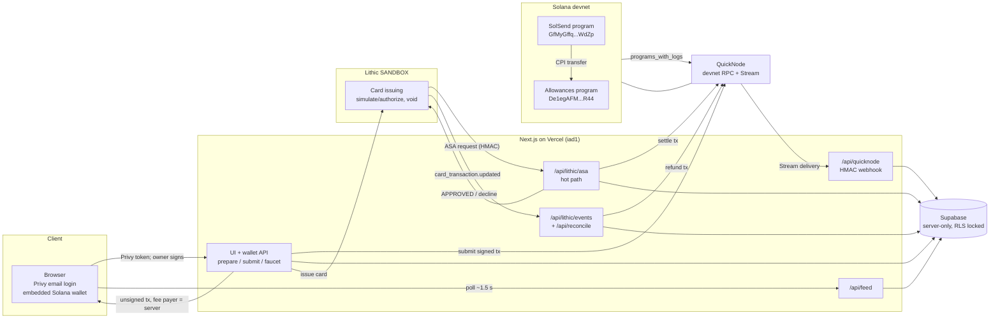

# SolSend architecture

Sandbox + Solana devnet. Lithic is the **sandbox** issuer; no real card network settles. Contracts and ownership are in [CP1-CONTRACTS.md](CP1-CONTRACTS.md); the trust model is in [TRUST.md](TRUST.md). Evidence for each flow is indexed in [EVIDENCE.md](EVIDENCE.md).

## Components



QuickNode appears twice on purpose: it is the **RPC** for every transaction we send and the **Stream** that independently confirms each onchain event in the activity page and cross-checks every settlement against its card authorization. A GitHub Actions cron also calls `/api/reconcile` as a safety net.

## Flows

### 1. Create card (setup transaction, card transaction, Lithic issue)

The one-time wallet setup initializes the owner's Allowances Subscription Authority and delegates the USDC token account to it. After that, each card is one owner signature. Card creation is a recoverable workflow, not an atomic one: the onchain card is registered first, Lithic second.

```mermaid
sequenceDiagram
  autonumber
  participant U as Browser + Privy
  participant S as Next.js API
  participant C as Solana devnet
  participant L as Lithic sandbox
  U->>S: POST /api/wallet/setup
  S-->>U: unsigned tx (fee payer = server)
  U->>S: POST /api/tx/submit (owner-signed)
  S->>C: add fee payer signature, send, wait confirmed
  U->>S: POST /api/cards/prepare (store, limit, kind)
  Note over S: card row = onchain_pending; intent = sha256 of message, 2 min expiry
  S-->>U: unsigned tx: createFixedDelegation + register_card
  U->>S: POST /api/tx/submit (owner-signed)
  Note over S: message must be byte-identical to the stored intent
  S->>C: send, wait confirmed
  Note over C: delegation (delegatee = Card PDA) and Card account exist; known store is pre-locked
  S->>L: POST /v1/cards (outer limit 2x, tags = card PDA)
  L-->>S: card token, last four
  S-->>U: card issued (on failure: lithic_failed + Retry)
```

### 2. Swipe (ASA to settle to confirm to reply)

```mermaid
sequenceDiagram
  autonumber
  participant M as Sandbox store (Demo store)
  participant L as Lithic sandbox
  participant A as /api/lithic/asa
  participant C as Solana devnet (SolSend + Allowances)
  participant Q as QuickNode Stream
  participant F as /api/quicknode + feed
  M->>L: simulate/authorize (amount, merchant)
  L->>A: ASA request (HMAC signed)
  A->>A: verify HMAC, map card tag to Card PDA, gates (status, USD, card OPEN, outage flag)
  A->>C: settle(amount, auth_hash, merchant_hash) signed by settlement authority
  Note over C: Card PDA signs CPI into Allowances transfer; USDC moves owner ATA to treasury ATA; SettlementRecord created
  C-->>A: confirmed
  A-->>L: APPROVED (only now)
  Note over A,C: deadline 4.5 s; error, timeout or unknown state replies decline
  C->>Q: CardSettled event in logs
  Q->>F: delivery (HMAC, replay-protected)
  F->>F: join auth_hash to authorization; upsert feed row
```

On a program error the ASA replies a mapped decline and the failed transaction signature is kept as evidence (for example `MerchantMismatch` becomes `UNAUTHORIZED_MERCHANT`, an Allowances cap error becomes `INSUFFICIENT_FUNDS`). The full mapping table is in CP1-CONTRACTS.md (F4).

### 3. Void to refund

```mermaid
sequenceDiagram
  autonumber
  participant U as Browser
  participant S as Next.js API
  participant L as Lithic sandbox
  participant R as Reconciler
  participant C as Solana devnet
  U->>S: POST /api/demo-merchant/void
  S->>L: simulate/void
  L-->>S: 201 accepted
  Note over L: sandbox voids are asynchronous
  L->>R: card_transaction.updated (status VOIDED)
  R->>R: verify HMAC, dedupe on webhook-id
  R->>C: refund(amount - refunded, auth_hash) signed by settlement authority
  Note over C: treasury ATA to card.source_token_account only; capped by the record
  C-->>R: confirmed
  R->>R: mark reconcile_action = refunded
  R-->>U: feed shows USDC returned; card limit stays used
```

The reconciler follows the **Lithic transaction status** (`DECLINED`, `VOIDED`, `EXPIRED` mean refund the remainder), not our own database and not the `result` field, which stays `APPROVED` after a void. The same path refunds a settle that landed after we had already declined. A cron sweep catches missed events. The consumed allowance is not restored.

### 4. Revoke all

```mermaid
sequenceDiagram
  autonumber
  participant U as Browser + Privy
  participant S as Next.js API
  participant C as Solana devnet
  U->>S: POST /api/cards/revoke-all
  S-->>U: one unsigned tx, up to about 12 revokeDelegation ixs
  U->>S: POST /api/tx/submit (owner-signed)
  S->>C: send, wait confirmed
  Note over C: every live delegation closed in the Allowances program; rent returns to the sponsor
  Note over U,C: the owner can also sign this revoke without SolSend, directly against Allowances
```

A revoked card can never be settled: the delegation is gone, and the ASA maps that failure to a `CARD_PAUSED` decline. Signature-level proof of close plus revoke, and of settle failing afterwards, is in [EVIDENCE.md](EVIDENCE.md) (P19 to P21).

## Accounts and PDAs

| Account | Seeds / address | Holds | Who can write |
|---|---|---|---|
| Config | `["config"]` under SolSend | admin, settlement authority, USDC mint, per-tx max, idle seconds, paused flag, treasury bump | Admin (pause, rotate authority); created once by the program's upgrade authority |
| Treasury | `["treasury"]` (data-less PDA) | owns the treasury token account | Only the program signs for it |
| Treasury ATA | associated token account of Treasury and the USDC mint | USDC pulled by settles, awaiting refunds | Program (`settle` in, `refund` out) |
| Card | `["card", owner, card_id_le]` | kind, status, delegation, source token account (the only refund destination), label, merchant lock, totals | Program; owner (freeze, unfreeze, close); settlement authority (freeze only) |
| SettlementRecord | `["settle", auth_hash]` | card, amount, refunded | Created by `settle`, updated by `refund`, **never closed** |
| Subscription Authority | `["SubscriptionAuthority", owner, usdc_mint]` under Allowances | the token delegate over the owner's USDC account | Owner |
| Delegation | `["delegation", sa, owner, card_pda, nonce]` under Allowances (nonce = card id) | the cap; **delegatee = Card PDA** | Owner creates and revokes; the Card PDA transfers inside `settle` |

Commitments (never raw identifiers onchain): `auth_hash = sha256("solsend:auth:v1:" + lithic_token)`, `merchant_hash = sha256("solsend:merchant:v1:" + acceptor_id)`. Settle transactions carry no memo.

Card kinds: store-locked and one-time use an Allowances `FixedDelegation` (lifetime cap); subscription uses a `RecurringDelegation` (per-period cap). Status: Active, Frozen, Used, Closed.

Offchain state (Supabase, server-only): `users`, `cards` (issue state machine), `tx_intents`, `authorizations`, `feed_events`, `webhook_receipts`, `app_settings` (issuer-outage flag), `rate_limits`. There are no PAN, CVV or secret columns. Migrations: [0001_init.sql](../supabase/migrations/0001_init.sql), [0002_lockdown.sql](../supabase/migrations/0002_lockdown.sql).

## Trust boundaries

Summary of [TRUST.md](TRUST.md); read that file for the full statement.

| Party | Can | Cannot | Residual risk |
|---|---|---|---|
| **Owner** (Privy embedded wallet) | Create, freeze, unfreeze, close cards; revoke any delegation directly in Allowances; move USDC freely | | Loss of the Privy account |
| **Settlement authority** (server hot key) | `settle` one authorization, only while the card is Active, unpaused, not idle, at the locked merchant, within per-tx max and the remaining cap, only to the treasury PDA; `refund` only to the stored source; freeze (reduce-only) | Withdraw from the treasury; raise limits; unfreeze; pull a revoked, closed or used card; settle one authorization twice | **Trusted to attest each authorization.** A compromised key can pull live cards up to their caps into the treasury, nowhere else |
| **Admin** (deployer key) | Pause or unpause settles (refunds keep working); rotate the settlement authority | Touch user wallets or delegations; change card limits or source accounts; withdraw (no instruction exists) | Key custody |
| **Fee payer** (server key) | Pay fees and rent; co-sign only a message byte-identical to a stored, unexpired, unconsumed intent | Move user funds; sign arbitrary transactions | Devnet SOL balance |
| **Program upgrade authority** (deployer key) | Upgrade the SolSend program on devnet | | **Largest assumption.** Freeze the program after the hackathon |
| **Lithic (sandbox)** | Sends HMAC-signed authorization requests and events; outer spending limits | Settle without our reply | The program cannot verify Lithic's signature onchain |
| **QuickNode** | RPC and Stream delivery | Authorize anything | Deliveries are notifications; decisions use RPC reads at `confirmed`. Trial limits apply |
| **Supabase** | Holds app state | Be reached from the browser | Server secret key; RLS is on with no policies |

Boundary rules worth restating: the chain, not Lithic or the database, is the spending gate; Lithic limits are a looser outer circuit breaker (2x); every ASA path that is not a confirmed settle declines.
